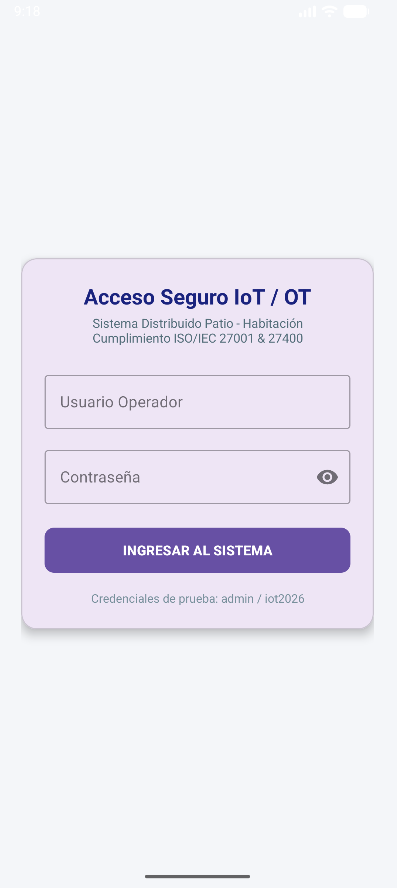
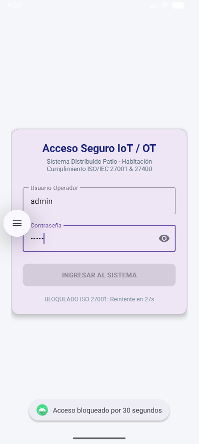
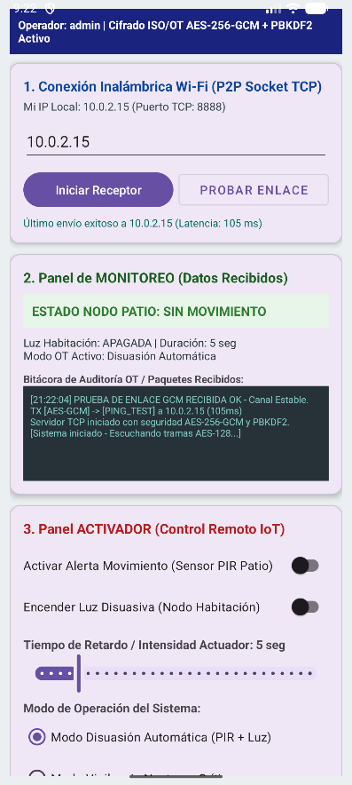
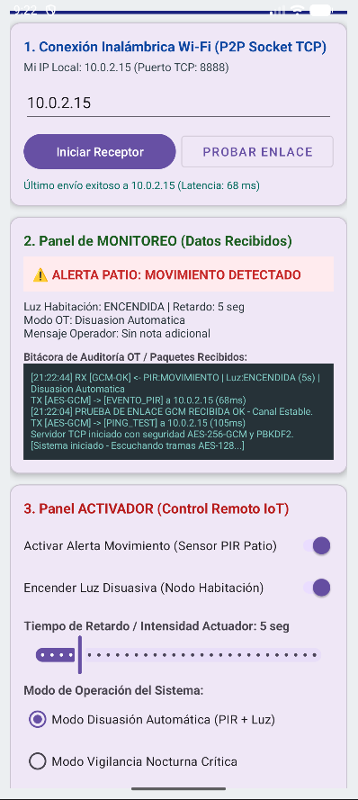

# Sistema de Seguridad y Monitoreo IoT/OT - Cumplimiento ISO/IEC 27001 & 27400

Aplicación nativa Android desarrollada en **Kotlin** para el monitoreo de sensores PIR y control remoto de actuadores sobre red local mediante **Sockets TCP P2P**, implementando controles criptográficos y de acceso alineados con las normas **ISO/IEC 27001** e **ISO/IEC 27400**.

---

## 🔒 Arquitectura de Seguridad Implementada

### 1. Autenticación Local con SQLite + PBKDF2 y Sal Aleatoria (`LoginActivity.kt`)
* **Persistencia Segura:** Las credenciales de los operadores no se almacenan en estructuras estáticas en memoria. Se implementó una base de datos local **SQLite** (`SeguridadIoT_Users.db` mediante `SQLiteOpenHelper`).
* **Derivación Criptográfica (PBKDF2):** Cada usuario registrado posee una **sal criptográfica única de 16 bytes** generada con `SecureRandom`. Las contraseñas se procesan utilizando el algoritmo `PBKDF2WithHmacSHA256` con **10.000 iteraciones** y longitud de salida de **256 bits**.
* **Comparación en Tiempo Constante:** La validación de hashes se realiza mediante `MessageDigest.isEqual()` para mitigar ataques de temporización (*timing attacks*).

### 2. Bloqueo Temporal Persistente Anti-Fuerza Bruta (`SharedPreferences`)
* **Política de Bloqueo:** Tras **3 intentos fallidos consecutivos**, el sistema bloquea el acceso durante **30 segundos**.
* **Persistencia de Estado:** Tanto el contador de intentos fallidos (`failed_attempts`) como la marca de tiempo de desbloqueo (`lockout_until`) se almacenan en `SharedPreferences` (`SeguridadIoT_AuthPrefs`). Si la aplicación se cierra o reinicia durante el periodo de castigo, el bloqueo y la cuenta regresiva en vivo (`CountDownTimer`) se mantienen activos.

### 3. Cifrado Autenticado de Tramas IoT con AES-256-GCM y Derivación PBKDF2 (`MainActivity.kt`)
* **Eliminación de Claves Fijas y Modo ECB:** Se reemplazó por completo el cifrado `AES-ECB` y cualquier clave estática en el código fuente.
* **Derivación Dinámica de Clave:** En cada transmisión TCP, se deriva una clave simétrica AES de **256 bits** mediante `PBKDF2WithHmacSHA256` (10.000 iteraciones y sal aleatoria de 16 bytes) a partir de la frase de sesión autenticada por el operador.
* **Cifrado Autenticado (`AES/GCM/NoPadding`):** Cada paquete enviado genera un **Vector de Inicialización (IV) aleatorio de 12 bytes (96 bits)** mediante `SecureRandom` y una etiqueta de autenticación (**GCM Tag**) de **128 bits** (`GCMParameterSpec`).
* **Formato de Trama Segura:** Los paquetes viajan codificados en Base64 bajo la estructura `SALT_B64 : IV_B64 : CIPHERTEXT_B64`, garantizando confidencialidad, integridad y que dos mensajes idénticos produzcan textos cifrados completamente distintos.

---

## 📱 Evidencia de Funcionamiento y Auditoría de Latencia

### 1. Control de Acceso y Bloqueo Persistente (ISO/IEC 27001)
| Acceso Seguro IoT / OT | Bloqueo Temporal Activo (30s) |
| :---: | :---: |
|  |  |

### 2. Monitoreo OT, Cifrado AES-256-GCM y Medición de Latencia TCP
| Estado Normal y Enlace Estable | Alerta PIR y Bitácora AES-GCM con Latencia (ms) |
| :---: | :---: |
|  |  |

---

## 🛠️ Estructura del Proyecto y Compilación

El repositorio incluye la estructura completa de **Android Studio (Gradle Kotlin DSL)** lista para ser clonada y compilada directamente:

* `app/src/main/java/com/inacap/seguridadiot/LoginActivity.kt`: Gestión de base de datos SQLite, hashing PBKDF2 con sal aleatoria y bloqueo persistente de 30s.
* `app/src/main/java/com/inacap/seguridadiot/MainActivity.kt`: Servidor/Cliente Socket TCP en puerto `8888`, cifrado autenticado `AES/GCM/NoPadding` con IV aleatorio, derivación `PBKDF2` y bitácora de auditoría con cálculo de latencia en milisegundos.
* `app-debug.apk`: Instalador compilado listo para pruebas en dispositivos físicos o emuladores Android.

### Credenciales de Prueba Precargadas en SQLite
* **Administrador:** `admin` / `iot2026`
* **Operador OT:** `operador` / `ot2026`
